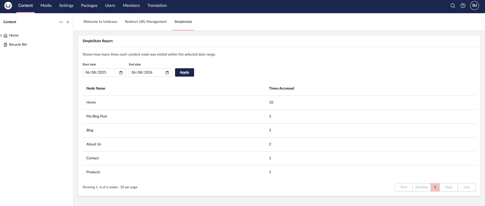

# SimpleStats

SimpleStats is a lightweight Umbraco backoffice package that tracks page views for your content
and shows the results inside the CMS. There's no external analytics service, no
JavaScript tracking snippet, and no cookies — every published request is counted server-side and
the results are shown in a dashboard next to your content tree.



The dashboard (Content section → **Simplestats**) lets you pick a date range and shows, per
content node, how many times it was visited within that range.

## How it works

A piece of middleware records a view for the currently resolved content node on every successful
request. View counts are buffered in memory and flushed to the database on a recurring background
job, so tracking has minimal impact on page response times.

## Requirements

- Umbraco 17.4+, 18.x, or 19.x
- .NET 10

## Installation

Install the NuGet package into your Umbraco web project:

```bash
dotnet add package Umbraco.Community.SimpleStats
```

SimpleStats registers itself automatically via an Umbraco composer — no changes to `Program.cs`
are required. On startup it creates its own database table (using the Umbraco-managed connection
string) and starts recording page views immediately.

Rebuild and restart your site, then open the **Content** section in the backoffice; a new
**Simplestats** dashboard tab will appear alongside your content tree.

## Configuration

SimpleStats is configured under the `SimpleStats` section in `appsettings.json`. All settings are
optional.

```json
{
  "SimpleStats": {
    "CommitIntervalSeconds": 60,
    "ExcludedNodeIds": [
      "3f2504e0-4f89-11d3-9a0c-0305e82c3301"
    ]
  }
}
```

| Setting                 | Type       | Default | Description                                                                 |
|--------------------------|------------|---------|-------------------------------------------------------------------------------|
| `CommitIntervalSeconds`  | `int`      | `60`    | How often, in seconds, buffered view counts are committed to the database.    |
| `ExcludedNodeIds`        | `Guid[]`   | `[]`    | Content node keys (GUIDs) to exclude from page-view tracking.                 |

### Excluding content nodes from tracking

Some nodes shouldn't be counted — for example a custom 404/error page, a preview or staging page,
or a node that's requested very frequently for reasons unrelated to real visits. Exclude a node by
adding its **content key** (the node's GUID, *not* its integer content ID) to `ExcludedNodeIds`.

To find a node's key in the Umbraco backoffice:

1. Open the content node you want to exclude.
2. Go to the **Info** tab.
3. Copy the value under **Id** (this is the node's GUID key).

Add it to `appsettings.json`:

```json
{
  "SimpleStats": {
    "ExcludedNodeIds": [
      "3f2504e0-4f89-11d3-9a0c-0305e82c3301",
      "9c858901-8a57-4791-81fe-4c455b099bc9"
    ]
  }
}
```

Requests to excluded nodes are skipped entirely — they are never counted or stored, and can be
added or removed at any time without restarting the site since the setting is monitored for
changes.

A JSON schema (`appsettings-schema.simplestats.json`) is included in the NuGet package to provide
IntelliSense and validation for these settings when editing `appsettings.json` in Visual Studio or
VS Code.

## Supported Umbraco versions

| Umbraco | .NET  | Status       |
|---------|-------|--------------|
| 17.x    | 10    | ✅ Supported |
| 18.x    | 10    | ✅ Supported |
| 19.x    | TBD   | 🔜 Planned   |

## Local development

```bash
# Restore NuGet packages
dotnet restore

# Build the solution
dotnet build

# Build the frontend assets (from src/SimpleStats.Client)
cd src/SimpleStats.Client
npm install
npm run build
```


## License

MIT
